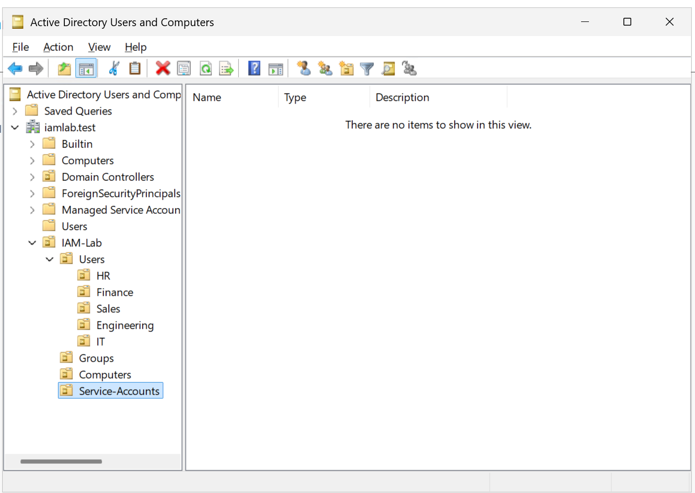
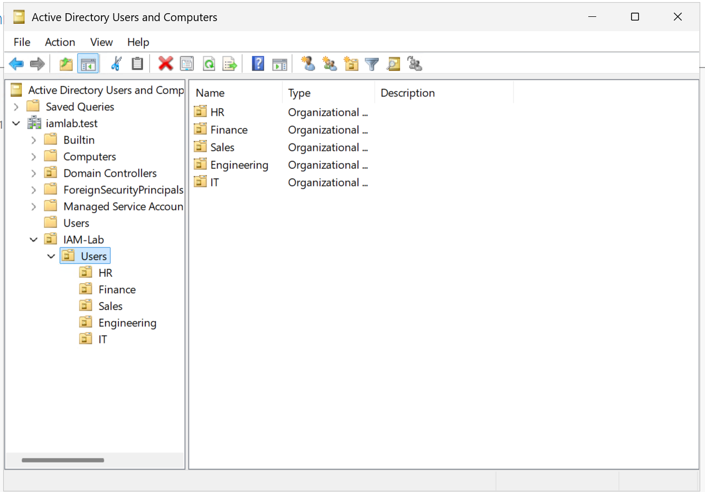
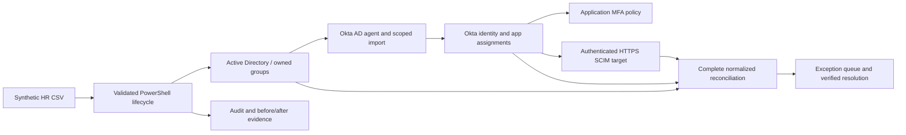

# 01 — Architecture and Design

## Objective

Build a realistic, isolated IAM foundation that treats a simulated HR employee roster as the source of identity attributes and Active Directory as the initial directory and role-group target.

## Environment

| Component | Implementation |
|---|---|
| Hypervisor | Hyper-V |
| Server | Windows Server 2025 Standard Evaluation |
| Domain controller | `IAM-DC01` |
| Forest/domain | `iamlab.test` |
| Network | `IAM-LAB` private switch |
| Domain controller address | `10.10.10.10/24` |

## Identity model

The employee source contains 50 synthetic identities across HR, Finance, Sales, Engineering, and IT. The source defines employee ID, department, position, manager, hire date, and employment status. Job position maps to one of 12 business roles, represented in AD by a Global Security group.

```text
CSV -> PowerShell -> Department OU + AD user -> Role group + Manager attribute
```

The initial lab is intentionally isolated. Cloud connectivity will be designed when an external integration is implemented; the domain controller will not be directly multihomed for convenience.

## Evidence





## Design boundary

AD group assignment demonstrates identity-to-role mapping, **not** enforcement of downstream application entitlements. Okta and application access integrations are future scope.


## Planned V2 architecture and ownership



The V2 components above are planned. HR owns employment facts; AD owns imported AD memberships; Okta controls its supported identity/app policies; the app owns native permissions/session handling. Every boundary needs stable identifier mappings, supported capabilities and independent verification.
