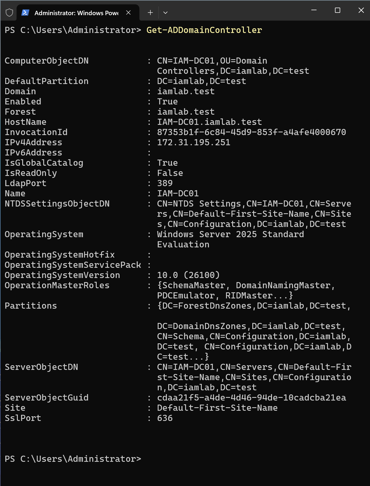
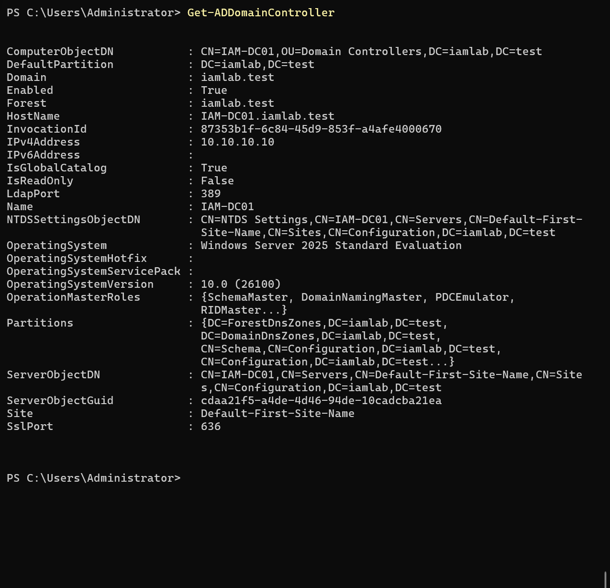

# 03 — Active Directory Implementation

## Objective

Deploy a functional AD DS forest, establish reliable DNS and a departmental OU hierarchy, and configure twelve Global Security role groups.

## Implementation

1. Created a Windows Server 2025 VM in Hyper-V and renamed it `IAM-DC01`.
2. Assigned `10.10.10.10/24` on the private `IAM-LAB` network.
3. Installed AD DS and promoted the server as the first DC in `iamlab.test`.
4. Configured AD-integrated DNS and Global Catalog.
5. Created the OU hierarchy below and twelve role groups.

```text
iamlab.test
└── IAM-Lab
    ├── Users
    │   ├── HR
    │   ├── Finance
    │   ├── Sales
    │   ├── Engineering
    │   └── IT
    ├── Groups
    ├── Computers
    └── Service-Accounts
```

## Verification

Validated domain/forest information, core directory services, domain controller discovery, LDAP SRV and A records, and DNS health. `dcdiag /test:dns /v` passed all applicable tests after network remediation.







## Security notes

Directory Services Restore Mode credentials and any administrative passwords are intentionally excluded from the repository.
