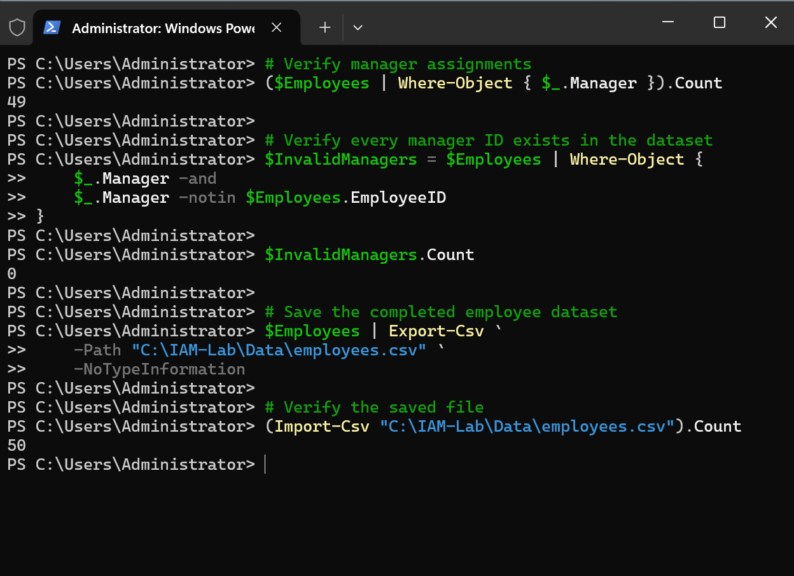
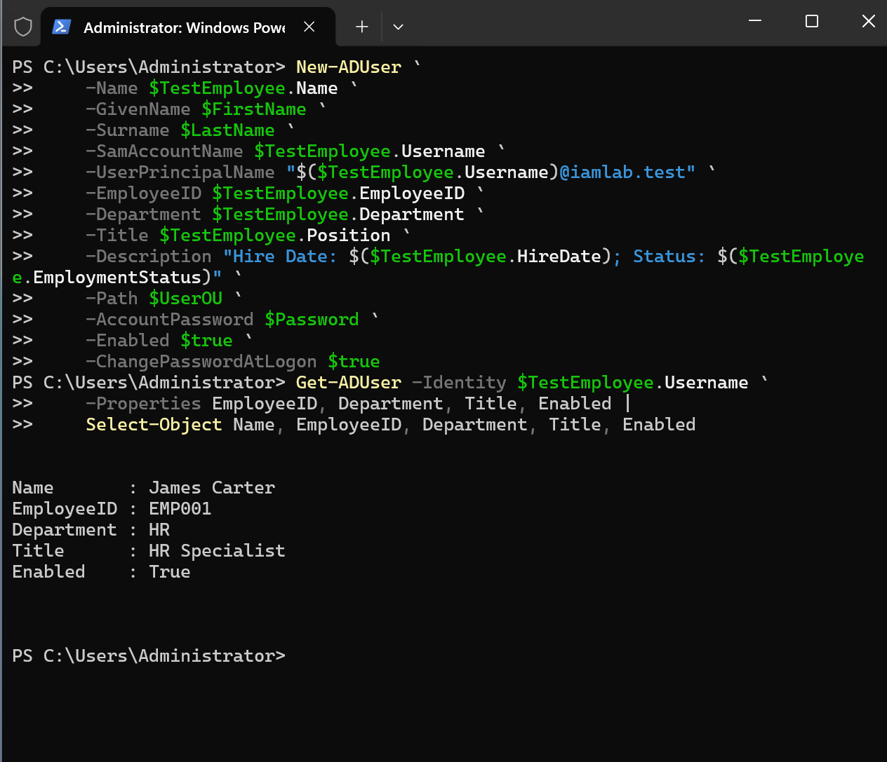
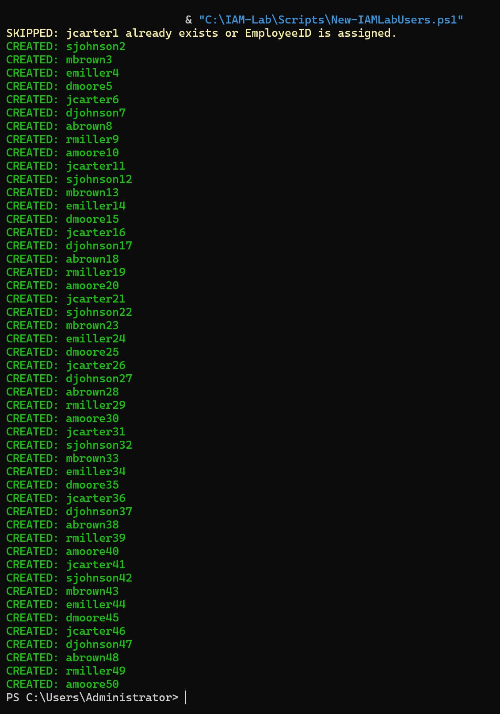
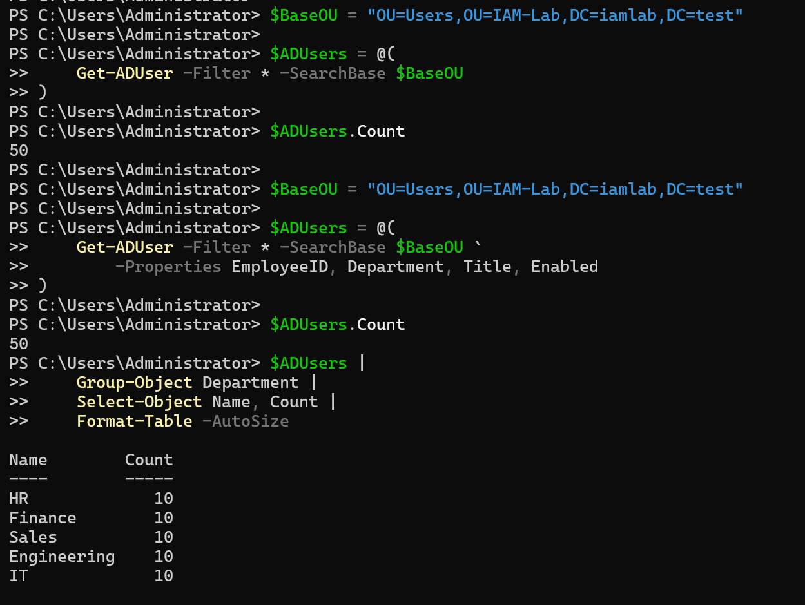

# 04 — Identity Provisioning

## Objective

Provision a consistent employee population from a synthetic HR-style CSV into departmental Active Directory OUs.

## Source and mapping

The employee CSV contains 50 records, 10 per department, with unique usernames and employee IDs (`EMP001` through `EMP050`). Manager references use employee IDs; 49 employees have a manager and one is the top-level manager.

Relevant fields: `Name`, `EmployeeID`, `Department`, `Position`, `Manager`, `HireDate`, `EmploymentStatus`, `Username`.

## Implementation

- Created the first AD account (`EMP001`) manually to verify attribute mapping.
- Used `New-IAMLabUsers.ps1` to create the remaining 49 accounts.
- Provisioned accounts into their appropriate departmental OUs.
- Used the original script's existence checks to avoid recreating the already present account.

Original tested script: [`New-IAMLabUsers.ps1`](../scripts/New-IAMLabUsers.ps1).

## Evidence









## Verified result

50 AD users were present and matched the expected departmental distribution. The consolidated validation checked employee attributes against the source CSV.
