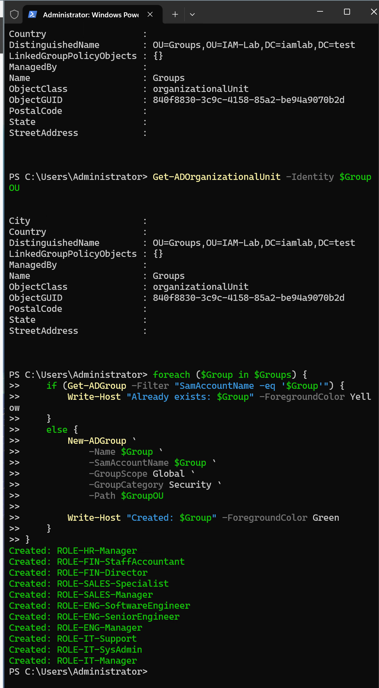
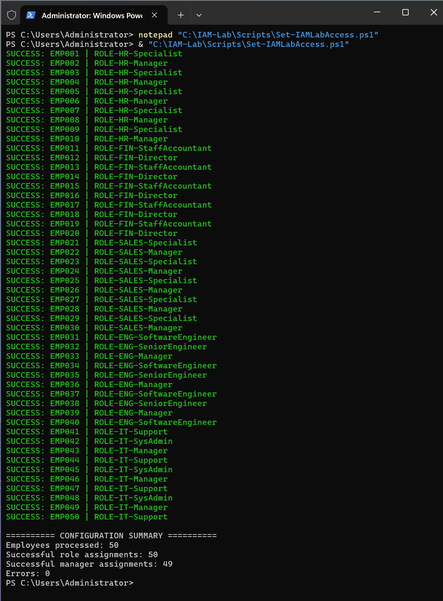

# 05 — RBAC and Access Management

## Objective

Translate employee job positions into AD role group memberships and establish employee manager relationships.

## Role groups

| Department | Groups |
|---|---|
| HR | `ROLE-HR-Specialist`, `ROLE-HR-Manager` |
| Finance | `ROLE-FIN-StaffAccountant`, `ROLE-FIN-Director` |
| Sales | `ROLE-SALES-Specialist`, `ROLE-SALES-Manager` |
| Engineering | `ROLE-ENG-SoftwareEngineer`, `ROLE-ENG-SeniorEngineer`, `ROLE-ENG-Manager` |
| IT | `ROLE-IT-Support`, `ROLE-IT-SysAdmin`, `ROLE-IT-Manager` |

All 12 groups are Global Security groups in `OU=Groups,OU=IAM-Lab,DC=iamlab,DC=test`.

## Implementation

`Set-IAMLabAccess.ps1` assigned role memberships using employee position mapping and populated the AD `manager` attribute using the employee ID references from the CSV.

The executed script reported **50 role assignments, 49 manager assignments, and 0 errors**.

## Evidence





## Security boundary

This phase validates role-to-group assignments. It does not establish that the groups grant specific application permissions; downstream entitlement mappings remain future work.
