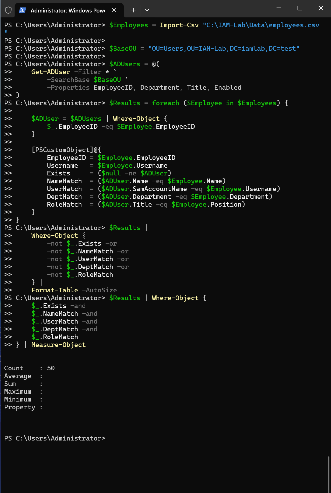
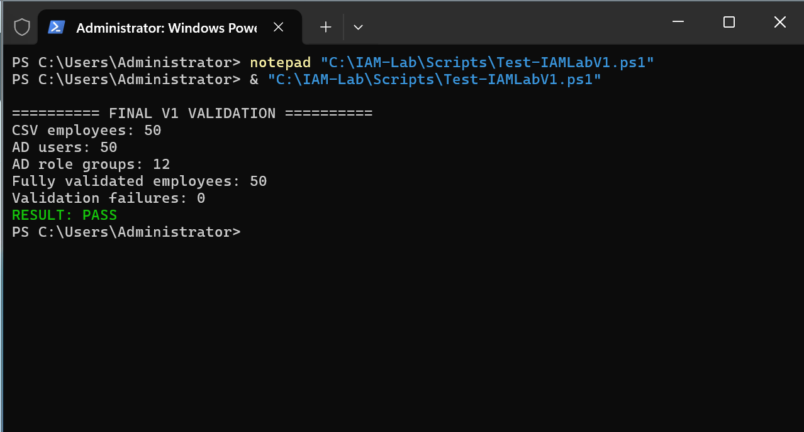

# 07 — Testing and Validation

## Objective

Independently validate the provisioned identities and their relationships against the synthetic HR source.

## Validation scope

The consolidated `Test-IAMLabV1.ps1` checked identity attributes, expected departmental OU, role group membership, manager references, and enabled/disabled account status.

## Final observed result

```text
========== FINAL V1 VALIDATION ==========
CSV employees: 50
AD users: 50
AD role groups: 12
Fully validated employees: 50
Validation failures: 0
RESULT: PASS
```





## Interpretation

The result demonstrates that all 50 tested accounts met the configured AD identity, organizational, role-membership, manager, and account-state expectations. It does **not** establish validation of Okta, SCIM, MFA, automated lifecycle transitions, or application entitlements.

Original tested validation script: [`Test-IAMLabV1.ps1`](../scripts/Test-IAMLabV1.ps1). The project-wide target of 15+ lifecycle scenarios remains planned until separately executed and documented.


## V2 validation plan — not executed

The expanded matrix is [tests/TEST-MATRIX.md](../tests/TEST-MATRIX.md). V2 must prove lifecycle transitions, safe reruns, upstream/downstream mapping, actual MFA, provisioning/deactivation, selective retries, reconciliation and exception resolution; existing V1 PASS does not cover these controls.

Each future scenario records starting state, exact action, expected state, independent check, cleanup, actual observation and evidence. The documentation update performs archive/link/code-syntax checks only and creates no V2 test results.
