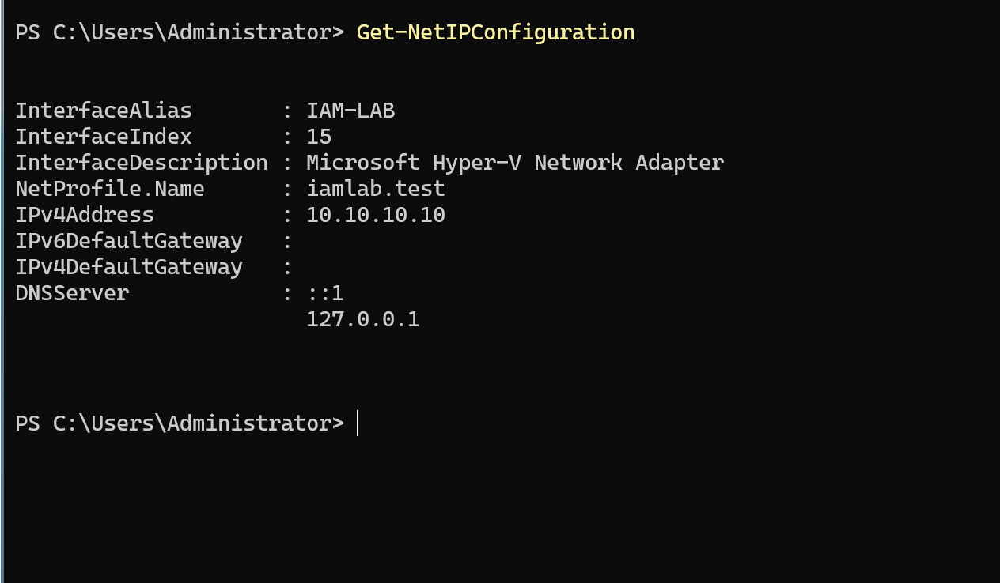
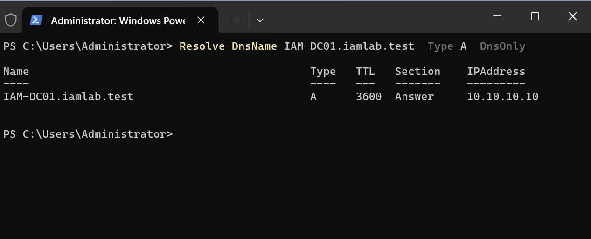
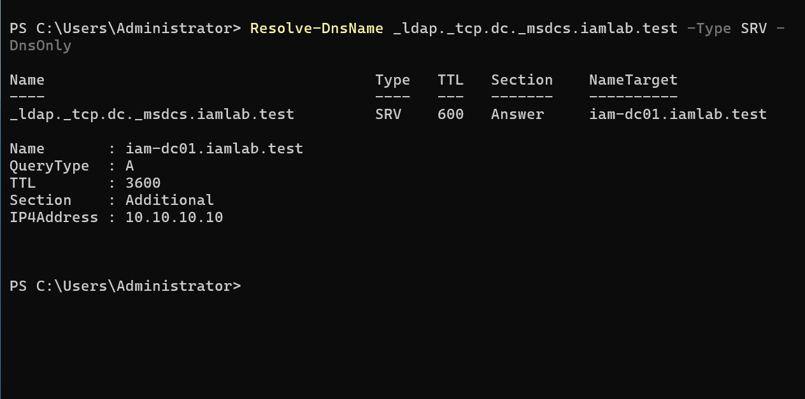

# 08 — Troubleshooting and Lessons Learned

## Case: Multihomed domain controller and DNS registration

### Symptom

After AD DS promotion, `IAM-DC01` had both a private `IAM-LAB` adapter and a second Hyper-V Default Switch adapter. Domain controller DNS and LDAP locator checks encountered ambiguity associated with the additional dynamically addressed interface.

### Investigation

Reviewed adapter addresses, DNS registration, A and SRV records, domain controller discovery, and `dcdiag /test:dns /v` results.

### Resolution

Removed the unnecessary Internet-facing adapter and retained a single NIC on the private network (`10.10.10.10/24`). Rechecked domain controller resolution, LDAP SRV records, and applicable DNS tests, which passed.







## Engineering lessons

- Treat domain controller DNS configuration as a foundational dependency, not an incidental networking detail.
- Keep lab networking simple until external integrations require Internet connectivity.
- Use a source-of-truth dataset and a consolidated validation script to make provisioning results repeatable and auditable.
- Separate implemented AD group assignments from future application entitlement enforcement.


## V2 troubleshooting plan — not observed incidents

- Identity or username conflict: stop, compare immutable IDs and source ownership; never silently adopt another account.
- Mover retains stale role: compare only the explicit twelve-group allowlist and remove the obsolete owned role; preserve unrelated memberships.
- Missing manager: validate the full feed and create all required identities before relationship changes; use the actual Manager field.
- API 401/403: correct grants/roles/authentication; no automatic retry. API 429: honor server guidance and bounded timing.
- SCIM create timeout/conflict: lookup and reconcile ownership before retry; do not duplicate resources.
- Downstream deactivation incomplete: keep the leaver exception open and verify actual target state/access, not just the request status.
- Incomplete collection: fix pagination/collector completeness; do not infer leavers or a clean report.
- Future MFA test passes without challenge: inspect session reuse, enrollment and actual app policy; repeat in a fresh session.

These are planned diagnostic procedures, not claims of encountered and resolved V2 failures.
